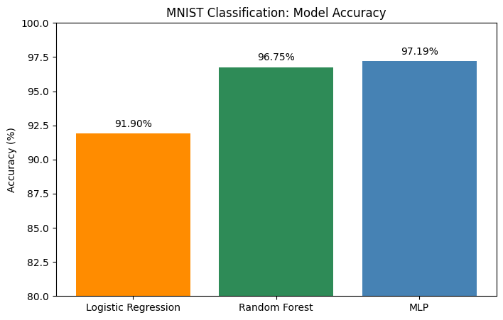
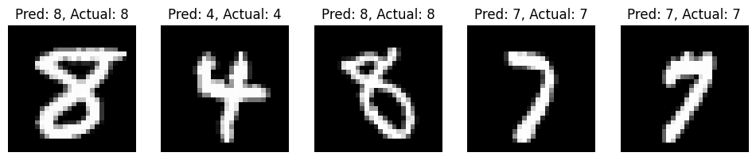
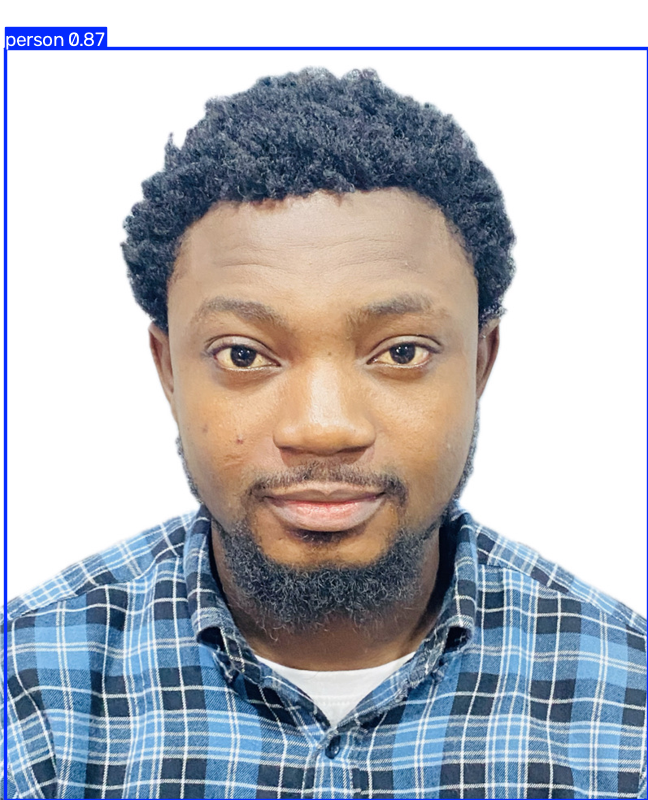

# Assignment 2, Part 2: MNIST Classification and YOLO Face Detection

## Task

1. Classify the MNIST handwritten digits with **Logistic Regression** and an **MLP neural network**, using the Random Forest code from class as the example, and compare their accuracy.
2. Take a photo of myself and detect my face with the **YOLO** model.

## Part 1: MNIST Classification

MNIST has 70,000 images of handwritten digits (0–9), each 28 × 28 pixels. OpenML was down (503 error), so I loaded the same 70,000 images through Keras, scaled the pixels to 0–1, and split the data 80/20 (56,000 training, 14,000 testing).

```python
# Logistic Regression
logistic_classifier = LogisticRegression(max_iter=200)
logistic_classifier.fit(X_train, y_train)

# MLP (Neural Network)
mlp = MLPClassifier(max_iter=1000)
mlp.fit(X_train, y_train)
```

| Model | Accuracy |
|---|---|
| Logistic Regression | 91.90% |
| Random Forest (class example) | 96.75% |
| MLP (Neural Network) | **97.19%** |





The MLP had the highest accuracy, followed closely by the Random Forest. Logistic Regression was about 5% lower because it is a linear model. It learns one weight per pixel, which can't capture the different ways people write the same digit. The MLP's hidden layer learns combinations of pixels (strokes and shapes), so it handles that variation better. All 5 sample test digits were predicted correctly by the MLP.

## Part 2: Face Detection with YOLO

```python
img_path = '/content/Bukola_headshot.jpeg'
image = Image.open(img_path)
image.thumbnail((800, 800))          # resize but keep the proportions
results = model(np.array(image))     # run YOLOv5
results.print()
results.show()
```



**Detected: person, confidence 0.87**

YOLO found me with 87% confidence. The label is "person" instead of "face" because the pre-trained YOLOv5 model (trained on the COCO dataset) has no face class, so it detects the whole person. Getting a box around only the face would require training the model on a face dataset.
